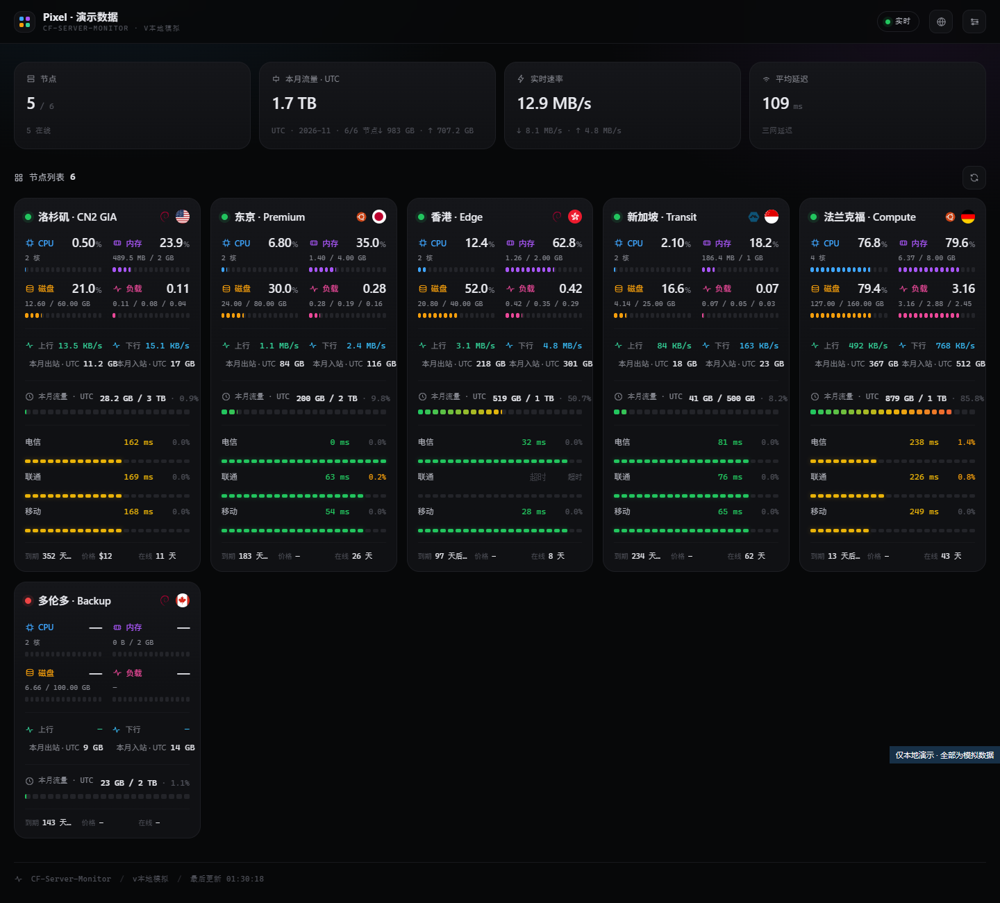
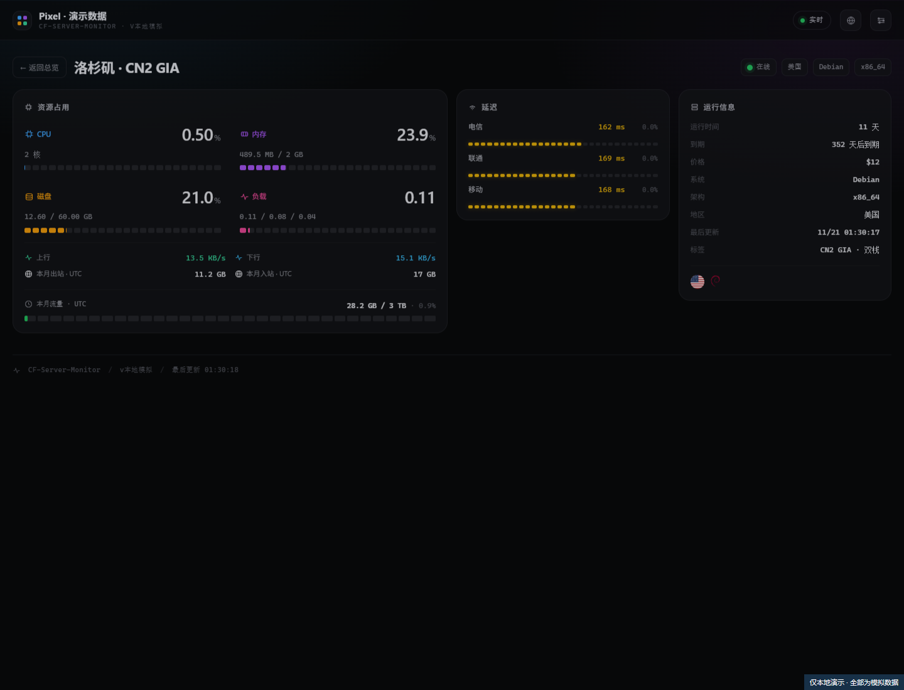
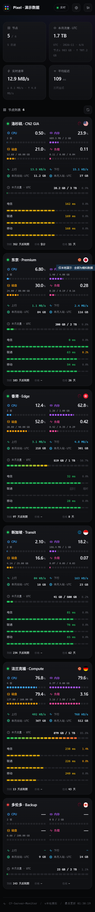

# Pixel · CF-Server-Monitor 主题

面向 [CF-Server-Monitor](https://github.com/huilang-me/CF-Server-Monitor) 的深色点阵主题：分段资源条、紧凑节点卡片、UTC 月流量、三网延迟及单节点详情。保留 Pixel 的视觉风格，不将其替换为 Iceglass。

> **验证状态：本地修复已完成。** 每个主题的 96 项自动化测试通过，Vite 发布构建成功，根目录入口和哈希资源已同步；并已使用本地模拟数据完成桌面 / 手机及正常 / 异常交互检查。未进行真实 Cloudflare 站点端到端验收；安装后请先使用管理员预览确认。详细记录见 [docs/VALIDATION.md](docs/VALIDATION.md)。

这是前台主题，不含监控后端、探针安装器或管理后台。需要已部署的 CF-Server-Monitor 及正常上报的探针。

## 修复后的样式截图

以下截图来自本次重建后的实际页面，全部为本地模拟数据，不包含真实服务器或实际测速结果。



<details><summary>节点详情与手机样式</summary>





</details>

## 安装与回滚

1. 确认现有 CF-Server-Monitor 可用，并支持第三方 GitHub tree 主题地址。
2. 使用实际配置的账号密码登录监控站点的 `/admin#/admin`。
3. 在外观 / 主题设置中填写：

   ```text
   https://github.com/famintt/cfsm-theme-pixel/tree/main
   ```

4. 先预览，确认数据、权限和手机显示正常，再应用。

本主题生产入口 `index.html` 和 `assets/` 位于**仓库根目录**，不要填写 `source/`，也不要照搬 Iceglass 的 `.../tree/main/theme` 地址。以上安装地址只适用于修改已构建并发布到对应分支后的版本。

Worker 在监控站点同域反代主题，后端 API、默认旗帜和 OS 图标仍由现有站点提供。启用已构建主题不需要部署新 Worker 或安装新探针。主题仓库必须能被 Worker 读取；本主题不提供私有仓库认证凭证。

需要固定版本时，将 `main` 替换为实际 40 位提交哈希。回滚时进入原项目默认后台，清除第三方主题地址或切回默认主题；不要通过删除数据库恢复界面。

## 页面与功能

| 路由 | 页面 |
| --- | --- |
| `/#/` | 节点总览、月流量、实时速率及网络质量 |
| `/#/server/:id` | 单台资源、网络读数和运行信息 |
| `/admin#/admin` | 原项目内置后台，Pixel 不接管 |

- 桌面为多列节点卡片，窄屏减少列数，手机单列。
- 深色点阵风格保持不变，不承诺独立的浅色皮肤。
- 资源容量按接口的 MB 转字节显示；CPU、内存和磁盘比例不混用单位。
- 上下行实时速度由在线节点计算，离线节点的旧读数不再冒充当前速度。
- 延迟 `0 ms` 是有效数据；超时、缺失值与真实零丢包分别显示。
- 后台“显示流量 / 到期 / 价格 / 三网详情”开关作用于卡片和直达详情，不只作用于先打开过总览的页面。
- 中文 / English 切换只影响当前浏览器；部分数据异常原因目前仍是中文。
- 后台入口始终使用默认 `/admin#/admin`。

Pixel 详情页没有完整历史曲线面板，因此不把 `/api/history/all` 列为使用本主题的必需接口。点阵延迟条是当前延迟的视觉刻度，**不是历史采样时间轴或实测带宽**。

## UTC 月流量标准

使用 `net_rx_monthly`（入站 / 下载）、`net_tx_monthly`（出站 / 上传），单位字节。不能用 `net_rx` / `net_tx` 的累计读数冒充本月。

只有满足下列条件的节点才计入 UTC 自然月：

1. `reset_day = 1`。
2. 最近上报属于当前 UTC 月份，且不是异常未来时间。
3. 上下行计数有效且非负；真实 `0` 不当成缺失。

月份区间从每月 1 日 `00:00 UTC` 到下月 1 日 `00:00 UTC` 前，不随浏览器本地时区变化。

| 显示 | 口径 |
| --- | --- |
| 总览双向月量 | 合格节点的本月上传 + 下载，包含仍有本月有效上报的离线节点 |
| 总览上下行 | 分别累加上述节点，标注已计入 / 总节点数 |
| 卡片和详情本月入站 / 出站 | 当前节点的 UTC 本月计数，无法确认时显示不可用 |
| 配额已用及百分比 | 根据 `traffic_calc_type` 选择 `total` 双向、`dl` 下载、`ul` 上传或 `max` 较大值 |

超额百分比文字保留实际数值，仅将点阵条长度限制到容器宽度。配额口径不同不能改变总览的双向流量定义。

非 1 号重置、未返回重置日、上月旧报告或缺失计数，均不能冒充 UTC 本月；页面会提示并排除这些节点。管理员可在原项目调整重置日，并确认探针实际生效。主题不写入后台设置，也无法补回月中安装、重装、校正或丢失的历史数据。此统计不作为精确计费账单。

## 字段说明

- **实时 `↑ / ↓`**：最近上报的 B/s 速率换算，不是 Mbps 带宽测试。
- **TCP**：探针上报的连接数，不是用户人数。
- **UDP**：套接字 / 端点数，不是 TCP 意义的已建立连接。
- **延迟 / 丢包**：读取探针测量。`null` 超时，`false` 或缺失表示未配置 / 未取样；不能显示为虚假的 `0%`。
- **分组 / 标签**：后台设定信息，不是自动检测 CN2 GIA、双栈或网络套餐。
- **到期**：过期要显示已过期，缺失到期日期不能证明永久有效。

## 权限与只读边界

- 当前版本只支持一个**同源根地址**后端。跨源、多后端、带路径、查询或凭证的 `apiBase` 会被明确拒绝。
- 通常不需要 `API_BASE`；单独部署到 GitHub Pages 不能自动连接远端后端。
- `/api/config` 匿名读取，不携带登录 Cookie / JWT，避免登录态配置请求间接触发远程版本查询。
- 是否允许读取私有数据，以实际数据请求结果为准，不能因匿名配置里的 `authorization=false` 强制跳转。
- 数据请求复用同源现有凭证；WebSocket 不把 JWT 放进 URL。
- 401 / 403 显示可操作的错误和默认后台链接。请先到 `/admin#/admin` 登录或验证，再返回刷新；主题不实现独立登录 / Turnstile，不绕过原权限。
- 主题不自动 POST 外观设置；浏览器偏好不会同步修改其他访客默认值。
- 隐藏页面暂停传输，恢复时补读当前页；详情始终只请求和订阅当前节点，不抓全量列表。
- 到达连接时限后必须手动继续，不能通过刷新读数、换路由或切后台绕过。WebSocket 不可用或节点超过 500 台时使用明确的定时刷新。
- 接口失败显示错误，不静默切换为演示数据。

## 本地开发、测试与构建

开发需要 Node.js **20.19+ 或 22.12+**。使用已构建主题的人不需要 Node.js。

```sh
cd source
npm ci --ignore-scripts
npm test
npm run build:theme
```

- `npm test` 运行客户端、UTC 月度、格式与 HTTP 凭证 / 错误处理回归用例；当前 **96 项通过**。
- `npm run build` 只生成 `source/dist/`。
- `npm run build:theme` 先构建，成功后同步 `index.html` 与 `assets/` 到仓库根目录，并清理被替换的哈希 JS/CSS；失败不改根目录。
- 编辑 `source/src/`，不要直接修改压缩产物。发布时必须同时更新源代码、根入口和对应资源。

### 无需真实后端的本地演示

在仓库根目录执行：

```sh
node source/scripts/demo.mjs
```

然后打开 `http://127.0.0.1:4179/`。本地服务直接使用仓库根目录已构建的入口 / 资源，只返回内置模拟节点和历史样本，页面明确标注“全部为模拟数据”，不读取真实服务器、Cookie 或远程后端，也不进行后台写入。服务仅监听本机；可通过 `PORT` 环境变量更换端口，按 `Ctrl+C` 停止。

如果要先修改源码，可执行 `npm run build:theme` 更新产物，再运行 `npm run demo`（在 `source/` 内）。演示服务器不是生产后端，不要部署成正式监控 API。

需要连接已授权后端开发时，在不提交的 `source/.env.local` 中配置授权使用的本地后端：

```dotenv
VITE_DEV_PROXY_TARGET=http://127.0.0.1:8787
```

运行：

```sh
npm run dev
```

Vite 代理 `/api`、`/flags`、`/os-icons`。生产 / 开发接口失败会显示错误，不自动回退模拟数据；本地演示必须显式运行上面的演示服务。不要提交真实账号、API Secret、令牌或服务器资料。

## 目录

```text
index.html                 # 已同步的正式入口
assets/                    # 与入口匹配的哈希产物
source/
  src/                     # Vue 组件和只读客户端
  test/                    # 回归测试
  scripts/                # 成功构建同步、显式模拟演示
  package.json
  package-lock.json
  vite.config.js
docs/                      # 修复后截图和验证报告
README.md
LICENSE
UPSTREAM-LICENSE.txt
```

## 验证范围与限制

本地 96 项测试、正式构建及模拟后端浏览器检查已完成。截图使用本次构建产物生成；仍未在真实 Cloudflare 部署环境进行端到端验收。

上线前检查首页 / 直达详情、后台显示开关、手机横向溢出、零延迟和超时、UTC 月界、`dl/ul/max` 配额、离线节点速率、401/403 后恢复、连接时限。不要依据旧 README 的 Beta 标签推断所有历史版本兼容。

主题不提供后台、自动线路认证、测速或完整历史趋势图。保留 `Powered by CF-Server-Monitor` 署名。

## 许可

主题原有 [MIT License](LICENSE) 保留。共享只读客户端参考 Iceglass，许可见 [ICEGLASS-LICENSE.txt](ICEGLASS-LICENSE.txt)，上游许可见 [UPSTREAM-LICENSE.txt](UPSTREAM-LICENSE.txt)。感谢 CF-Server-Monitor 的公开主题接口。
