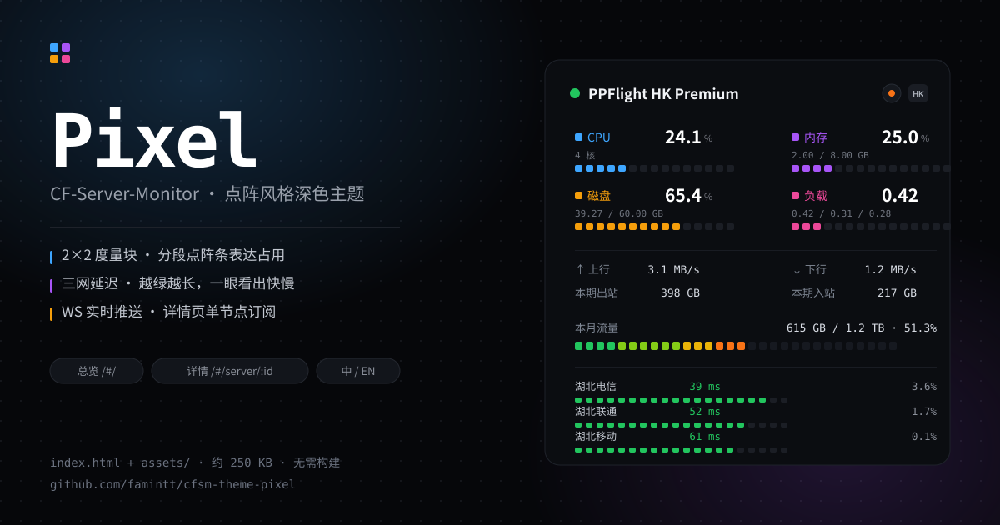
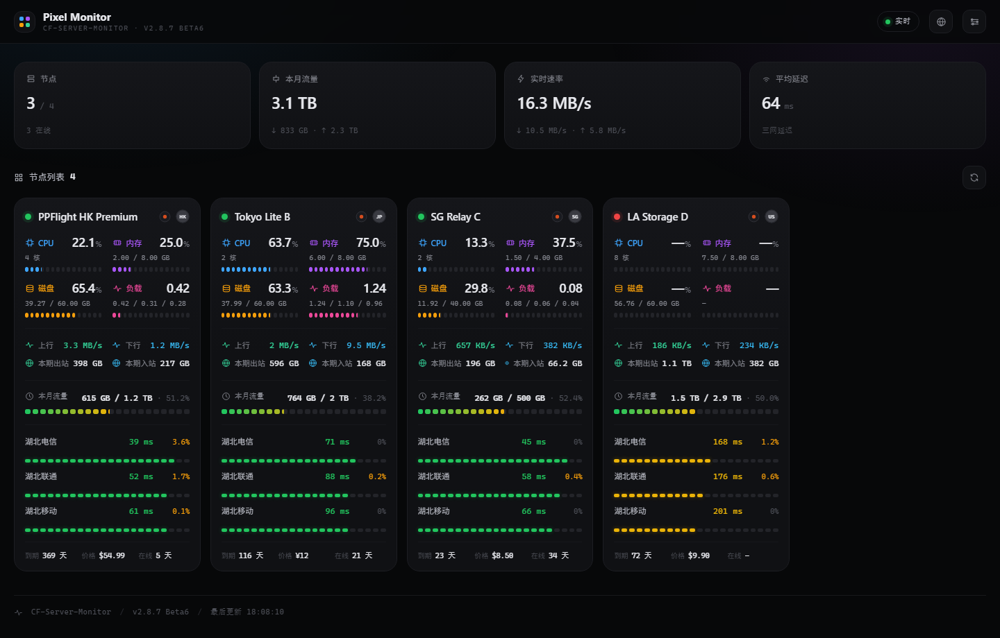
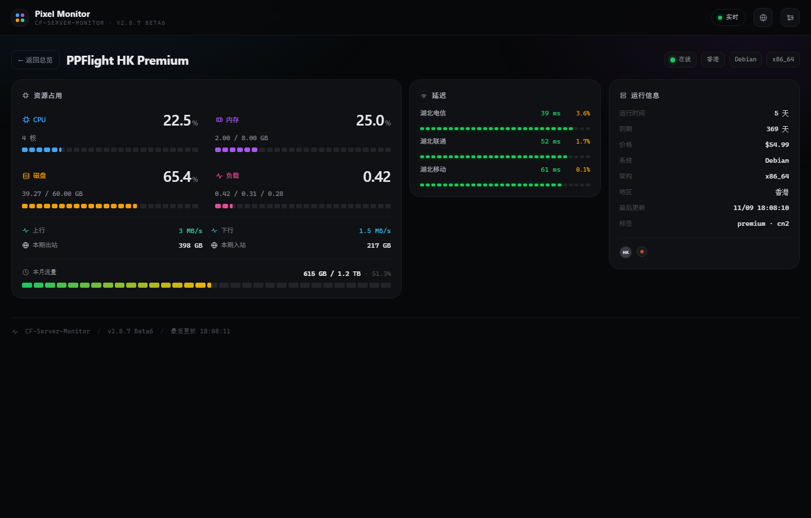
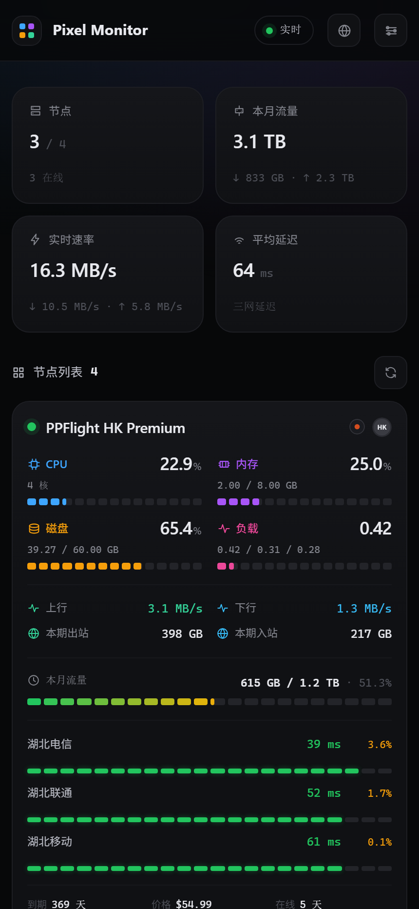
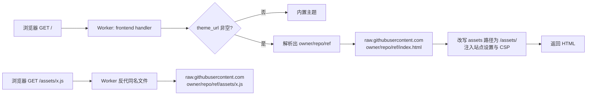

# Pixel · CF-Server-Monitor 主题

[](https://vuejs.org/)
[](https://vite.dev/)
[](https://github.com/huilang-me/CF-Server-Monitor)
[](LICENSE)

> 点阵风格的深色监控面板：2×2 度量块、分段点阵条、三网延迟点阵、WS 实时推送。
> 只读 `index.html` + `assets/`，**不需要构建、不需要改后端**，填一个 GitHub tree 地址即可上线。



---

## 一句话安装

在 CF-Server-Monitor 后台把「第三方主题地址」填成：

```
https://github.com/famintt/cfsm-theme-pixel/tree/main
```

保存 → 打开首页 → 看到深色点阵面板即成功。详细步骤见 [三步接入](#三步接入)。

---

## 目录

- [这个主题是什么](#这个主题是什么)
- [界面预览](#界面预览)
- [界面与功能](#界面与功能)
- [和极光主题有什么不同](#和极光主题有什么不同)
- [仓库结构](#仓库结构)
- [准备工作](#准备工作)
- [三步接入](#三步接入)
- [详细步骤](#详细步骤)
- [先预览，再上线](#先预览再上线)
- [后台设置如何影响主题](#后台设置如何影响主题)
- [回滚](#回滚)
- [工作原理](#工作原理)
- [缓存与更新](#缓存与更新)
- [常见问题](#常见问题)
- [源码与构建](#源码与构建)
- [已知取舍](#已知取舍)
- [兼容性](#兼容性)
- [致谢](#致谢)

---

## 这个主题是什么

CF-Server-Monitor 支持「第三方主题」：后台填一个 GitHub 仓库地址，Worker 会把那个仓库里的
`index.html` 和 `assets/` 反向代理到你自己的域名下，于是整个前台换成第三方作者写的界面，
而数据接口、后台管理、告警、定时任务全部保持不变。

本项目就是这样一个第三方主题，特征是**像素 / 点阵语言**：

| 元素 | 做法 |
| --- | --- |
| 占用率 | 分段点阵条（15 段），按 CPU / 内存 / 磁盘 / 负载各用一种颜色 |
| 流量 | 30 段热力条，绿 → 黄 → 橙，用量越高颜色越暖 |
| 三网延迟 | 每行一条点阵条，**越绿越长**；丢包只标数字 |
| 整体 | 固定深色控制台风格，等宽数字，信息密度高 |

技术上是一个 Vue 3 + Vite 6 的单页应用，构建产物共 8 个文件、约 182 KB，没有任何后端依赖。

---

## 界面预览

| 总览（浅色主题的访客看到的就是这一页） | 节点详情 |
| --- | --- |
|  |  |

<p align="center">
  
</p>

---

## 界面与功能

### 路由

| 路径 | 页面 | 说明 |
| --- | --- | --- |
| `/#/` | 总览 | 四格汇总 + 节点卡片网格 |
| `/#/server/:id` | 节点详情 | 单节点大度量、延迟明细、运行信息 |
| `/admin#/admin` | 后台 | **始终是内置后台**，主题不接管 |

### 总览页

- **顶部四格汇总**：`在线/总数`、本月流量合计、实时速率合计、三网平均延迟。
- **一行 5 张卡**：桌面（≥1400px）默认 5 列，屏幕变窄依次降到 4 / 3 / 2 / 1 列。
- **节点卡片**，每张卡包含：
  - 状态点（在线绿 / 离线红）+ 节点名 + 系统图标 + 地区国旗；
  - 2×2 度量块：CPU、内存、磁盘、负载，各带副行（核数 / 已用总容量 / 负载三元组）与分段点阵条；
  - 网络四格：↑ 上行、↓ 下行、本期出站、本期入站；
  - 本月流量（后台开启「显示流量」时），带热力条与 `已用 / 上限 · 百分比`；
  - 三网延迟（后台开启「显示三网延迟」时）：电信 / 联通 / 移动的毫秒数与丢包率；
  - 底部：到期天数、价格、在线时长。
- **离线节点**不显示假数据：数值一律 `—`，点阵条清空，只保留最后已知的累计流量。
- 首屏是骨架屏；接口失败显示错误面板和「重试」；没有节点时显示空态提示。

### 节点详情页

- 顶部返回按钮 + 节点名 + 状态 / 地区 / 系统 / 架构 四个标签。
- **资源占用**：CPU、内存、磁盘、负载四块大度量（24 段点阵条），下面是网络四格与本月流量。
- **延迟**：三行点阵，越绿越长；右侧给出毫秒数与丢包率。
- **运行信息**：运行时长、到期、价格、系统、架构、地区、最后更新时间、标签。
- 进入详情页后才对该节点单独订阅 WebSocket，离开即断开，省流量。

### 全局

- **实时**：总览页订阅全部节点，详情页只订阅当前节点；右上角小圆点表示连接状态（`实时` / `连接中` / `已断开`）。
- **中英切换**：右上角地球图标，语言存 `localStorage`。
- **后台入口**：右上角按钮直达 `/admin#/admin`，未登录时后台会自己要求输入账号密码。
- **页脚**：`Powered by CF-Server-Monitor` 链接回上游仓库，并显示当前版本号和最后刷新时间。
- 页面切到后台标签页时暂停推送，切回来立即重连并刷新。

---

## 和极光主题有什么不同

两个主题都是同一个作者、同一套数据接口，取向不同：

| | Pixel（本主题） | Aurora（极光） |
| --- | --- | --- |
| 风格 | 固定深色、点阵、等宽数字 | 明暗双色、卡片式 |
| 可配置 | 无（设计语言固定） | 外观菜单：明暗 / 主题色 / 密度 / 迷你走势 / 视图切换 |
| 列表视图 | 无 | 有 |
| 墨水屏视图 | 无 | 有（`/#/epaper`，可打印成 PDF） |
| 适合 | 长时间盯盘的深色大屏 | 需要换肤、要打印的场景 |

---

## 仓库结构

```
cfsm-theme-pixel/
├── index.html                     # 构建产物入口（主题加载器读的就是这个）
├── assets/                        # 构建产物：8 个 js/css，约 182 KB
│   ├── index-BJwlcxxF.js          # 145 KB，Vue 运行时 + 通用逻辑
│   ├── index-CbvQQ41A.css         # 15 KB，全部样式与设计变量
│   ├── Dashboard-COW4zYzo.js
│   ├── Dashboard-DMlLoFsP.css
│   ├── ServerDetail-CGg2exsp.js
│   ├── ServerDetail-CFsPjZd5.css
│   ├── PixelFooter-DOd_2jlt.js
│   └── PixelFooter-BIHoZK52.css
├── source/                        # 完整源码（不影响主题加载）
│   ├── src/
│   ├── index.html
│   ├── package.json
│   └── vite.config.js
├── docs/                          # 截图与封面
└── README.md
```

> 根目录只有 `index.html` + `assets/` 是**必须**的：CF-Server-Monitor 只反代这两个路径，
> `source/` 与 `docs/` 不会被访客访问到，放在这里纯粹是为了开发方便。

---

## 准备工作

1. 一个已经跑起来的 CF-Server-Monitor（2.8.7 Beta5 及以上）。
2. 知道自己的 Worker 域名，例如 `https://monitor.example.workers.dev`。
3. 知道后台管理员密码 —— 就是部署时设置的 `API_SECRET`，默认用户名 `admin`。

不需要的东西：不需要 Node、不需要构建、不需要 fork、不需要改 `wrangler.toml`。

---

## 三步接入

### 第 1 步：复制主题地址

```
https://github.com/famintt/cfsm-theme-pixel/tree/main
```

格式必须是 `https://github.com/<用户>/<仓库>/tree/<分支或提交>`。

### 第 2 步：填进后台

登录 `https://你的域名/admin#/admin` → 进入「设置」→ 找到「站点设置」或「外观设置」里的
**第三方主题地址**（部分版本写作「主题 GitHub tree 地址」）→ 粘贴上面的地址 → 保存。

### 第 3 步：验证

打开 `https://你的域名/`，出现深色点阵面板即成功。若仍是旧界面，按
[缓存与更新](#缓存与更新) 处理。

---

## 详细步骤

### 1. 确认地址格式

主题加载器会严格校验这个地址，规则是：

- 必须是 `https://github.com/...`；
- 路径里必须出现 `/tree/`，后面跟分支名或提交哈希；
- 用户名、仓库名、ref 只允许字母、数字、`.`、`_`、`-`；
- 地址里不能带 `?query`、`#hash`、账号密码。

| 写法 | 结果 |
| --- | --- |
| `https://github.com/famintt/cfsm-theme-pixel/tree/main` | ✅ 正确 |
| `https://github.com/famintt/cfsm-theme-pixel/tree/v1.0.0` | ✅ 正确（用 tag） |
| `https://github.com/famintt/cfsm-theme-pixel/tree/9c1f0ab...`（40 位提交） | ✅ 正确，最稳定 |
| `https://github.com/famintt/cfsm-theme-pixel` | ❌ 缺 `/tree/…`，**会被静默清空** |
| `https://github.com/famintt/cfsm-theme-pixel/tree/main/` | ⚠️ 末尾斜杠会被规范化掉，能用但不建议 |
| `git@github.com:famintt/cfsm-theme-pixel.git` | ❌ 只接受 https |

> 「静默清空」的意思是：保存后不报错，但 `theme_url` 变成空字符串，前台回到默认主题。
> 如果保存后发现没生效，先回后台确认这个字段还在不在。

### 2. 选择 ref：分支还是提交

- 用 `main`：跟随本仓库更新，**最省心**，但改版后你可能要重新适应界面。
- 用 40 位提交哈希：内容永久冻结，适合「部署完就不再动」的场景。

```bash
# 想锁定版本，取当前提交：
git ls-remote https://github.com/famintt/cfsm-theme-pixel.git refs/heads/main
```

### 3. 保存并检查

保存后刷新前台。主题资源是从 `raw.githubusercontent.com` 拉的，**第一次**可能慢一两秒，之后走缓存。
如果浏览器控制台报 `502 Theme index.html is unavailable`，说明 GitHub 那边取不到 `index.html`，
多半是 ref 写错或者仓库是私有的。

---

## 先预览，再上线

不想让访客立刻看到新主题，可以先自己预览：

1. 保持后台已登录；
2. 访问 `https://你的域名/?theme_url=https://github.com/famintt/cfsm-theme-pixel/tree/main`；
3. 你会看到带 `?theme_url=` 的那个主题，其他访客仍然看到旧主题；
4. 预览状态写在 cookie `cfsm_theme_preview` 里，有效期 1 小时；不带参数重新访问即退出预览。

预览要求管理员身份：未登录访问会得到 `401 Theme preview requires admin login`。

---

## 后台设置如何影响主题

主题只是「前台的一层皮」，下面这些后台开关它会读取并遵守：

| 设置项 | 在 Pixel 里的表现 |
| --- | --- |
| `site_title` | 顶栏品牌名、`<title>` |
| `favicon` | 浏览器标签图标 |
| `custom_bg` / `custom_bg_mobile` | 页面背景图（会盖住默认的径向光晕） |
| `custom_head` / `custom_script` | 原样注入 `<head>` / `</body>` 前 |
| `show_expire` | 卡片底部的「到期 X 天」 |
| `show_tf`（显示流量） | 本月流量行与热力条 |
| `show_three_net_details` | 三网延迟三行点阵 |
| `custom_ct_name` / `custom_cu_name` / `custom_cm_name` | 三网运营商显示名（默认 电信 / 联通 / 移动） |
| `display_mode`（条形/环形/表格） | **不生效** —— Pixel 使用自己的点阵表示 |
| `preferred_theme`（明暗） | **不生效** —— Pixel 固定深色 |
| `theme_options` | 本主题不读取，也不写回 |

---

## 回滚

三种方式，任选其一：

1. **清空地址**：后台把「第三方主题地址」清空并保存，前台立刻回到内置主题。
2. **换回旧 ref**：把 `/tree/main` 换成之前用过的提交哈希。
3. **预览兜底**：`?theme_url=` 只在预览 cookie 里生效，删掉 cookie 即恢复。

回滚是即时的（分支缓存最多 1 小时，见下一节）。

---

## 工作原理



几个关键点：

- **只代理两个路径**：`/`（读 `index.html`）和 `/assets/*`。所以主题仓库根目录必须有 `index.html`
  和 `assets/`，别把源码丢在根目录当入口。
- **同源**：反代发生在你自己的域名下，`window.location.origin` 就是 API 地址，不需要 CORS，
  也不需要配置 `api-base`。
- **后台不受影响**：`/admin` 永远使用内置应用，主题里只放一个跳转链接。
- **注入**：Worker 会替换 `<title>`、`favicon`，插入 `custom_head` / `custom_script` / 背景图，
  并重建 CSP，同时加上 `X-Frame-Options: DENY`。
- 常见错误码：`502 Theme index.html is unavailable`（取不到入口）、`Theme file not found`（资源 404）、
  `401 Theme preview requires admin login`（预览未登录）。

---

## 缓存与更新

| 你填的 ref 类型 | 服务端缓存 | 浏览器缓存 | 更新方式 |
| --- | --- | --- | --- |
| 分支名（`main`） | 1 小时 | 跟随响应头 | 等 1 小时，或换一个提交哈希 |
| 40 位提交哈希 | 24 小时 + `immutable` | 1 年 | 提交内容不会变，换哈希即可 |

也就是说：**想让改动立刻生效，就用新的提交哈希**；用分支名最多要等一小时。

---

## 常见问题

<details>
<summary>1. 保存后没反应，前台还是老样子？</summary>

先回后台确认「第三方主题地址」还在不在。最常见的原因是地址里少了 `/tree/`，被静默清空了。
</details>

<details>
<summary>2. 页面 502，提示 Theme index.html is unavailable？</summary>

GitHub 那边取不到 `index.html`。检查：ref 是否存在（分支名拼写、tag 是否存在）、仓库是不是私有的、
仓库根目录是否真的有 `index.html`。
</details>

<details>
<summary>3. 页面能开，但样式全丢？</summary>

通常是 `assets/` 路径问题。本主题的 `index.html` 引用的是 `./assets/index-*.js`，
加载器会改写成 `/assets/index-*.js`；如果你自己改过构建配置（比如换了 `base`），改写就会失效。
</details>

<details>
<summary>4. 数字一直是 —，或者一直显示离线？</summary>

`—` 表示该节点被判定为离线（最后上报超过 5 分钟）。检查节点上的 agent 是否在跑、`/api/servers` 是否正常返回。
</details>

<details>
<summary>5. 右上角显示「已断开」？</summary>

WebSocket 没连上。常见原因是反向代理/ CDN 不支持 WS，或后台的
`frontend_ws_timeout_minutes` 到期。刷新页面会自动重连；连续失败会退避重试。
</details>

<details>
<summary>6. 能改颜色吗？</summary>

不能通过后台改，这是设计上固定的。要换配色就改 `source/src/styles/main.css` 顶部的
`--cpu`、`--ram`、`--disk`、`--load`、`--up`、`--down` 等变量，然后重新构建，见 [源码与构建](#源码与构建)。
</details>

<details>
<summary>7. 支持浅色模式吗？</summary>

不支持。Pixel 的定位就是深色盯盘面板；如果需要明暗切换，用极光主题。
</details>

<details>
<summary>8. 手机能看吗？</summary>

可以。窄屏下四格汇总变两列，节点卡片单列，详情页三栏变单栏。
</details>

<details>
<summary>9. 会不会拖慢我的 Panel？</summary>

不会。它只是替换前台静态文件，数据仍然走原来的 `/api/*`；唯一的额外开销是首次拉取
`raw.githubusercontent.com` 上的资源，之后由 Worker 缓存。
</details>

<details>
<summary>10. 换主题会影响后台数据吗？</summary>

不会。主题只读接口，不写数据库；后台的节点、告警、设置都不受影响。
</details>

<details>
<summary>11. 为什么延迟那里只有一条点阵，截图里不是两条吗？</summary>

原设计稿（两条点阵分别表示延迟和丢包）需要历史采样数据，而接口只给当前值。
为了避免画出一条「假曲线」，这里用一条点阵表示延迟优劣（越绿越长），丢包只用数字标注。
</details>

---

## 源码与构建

根目录是**构建产物**，源码在 `source/`。想改样式或逻辑时：

```bash
cd source
npm install
npm run dev        # http://127.0.0.1:5173，代理 /api 到 127.0.0.1:8787
```

`vite.config.js` 里已经把 `/api`、`/flags`、`/os-icons` 代理到本地 wrangler dev（默认 8787 端口，
可用 `VITE_DEV_PROXY_TARGET` 覆盖），所以本地调试时前后端可以分开跑。

改完发布：

```bash
cd source
npm run build
cd ..
rm -rf assets index.html
cp -R source/dist/assets .
cp source/dist/index.html .
```

提交后记得把后台的主题地址换成新提交的哈希（分支名最多等 1 小时缓存）。

> 自动部署用的 GitHub Actions 工作流放在 `docs/deploy-pages.yml`，而不是 `.github/workflows/`。
> 原因是：如果你用带 `workflow` 权限之外的 token 推送，GitHub 会直接拒绝含工作流文件的提交。
> 想启用自动构建，把该文件复制到 `.github/workflows/` 再提交，并给 token 补上 `workflow` 权限。

### 目录速览

| 路径 | 作用 |
| --- | --- |
| `source/src/views/Dashboard.vue` | 总览页：汇总四格 + 卡片网格 + 骨架/错误/空态 |
| `source/src/views/ServerDetail.vue` | 详情页：大度量、延迟点阵、运行信息 |
| `source/src/components/NodeCard.vue` | 节点卡片（本项目的信息密度核心） |
| `source/src/components/SegBar.vue` | 分段点阵条，`value`（0–100）/ `cells` / `ramp`（flat / heat / duo） |
| `source/src/components/DotRow.vue` | 延迟点阵行 |
| `source/src/components/DashSummary.vue` | 顶部四格汇总 |
| `source/src/components/PixelHeader.vue` | 顶栏：品牌、实时状态、语言、后台入口 |
| `source/src/stores/monitor.js` | 数据层：`/api/config`、`/api/servers`、WS 订阅、断线重连 |
| `source/src/utils/format.js` | 单位换算、百分比、到期/价格文案 |
| `source/src/styles/main.css` | 全部样式与设计变量 |

### 常见改动位置

- **主色**：`--cpu`（`#3ea6ff`，同时充当整站的强调色）。
- **四块度量的颜色**：`--cpu` / `--ram` / `--disk` / `--load`；网络箭头用 `--up` / `--down`，状态用 `--ok` / `--warn` / `--bad`。
- **点阵密度**：`SegBar` 的 `cells`（卡片度量 15、卡片流量 22、详情度量 24、详情流量 32）。
- **每行卡片数**：`.grid { grid-template-columns: repeat(5, minmax(0, 1fr)) }` —— 默认一行 5 张。
- **断点**：`1400px` 降到 4 列、`1060px` 3 列、`900px` 2 列（同时汇总变两列）、`640px` 1 列。
- **页面宽度**：`.shell { width: min(1720px, 100% - 40px) }`。

---

## 已知取舍

- **只有深色**：不做明暗双主题，减少一半视觉维护成本。
- **延迟点阵表示「快慢」而非历史**：接口没有延迟历史，见 FAQ 第 11 条。
- **不使用 `theme_options`**：后台没有可调的项，换配色请改源码。
- **没有墨水屏视图**：需要打印/导出请用极光主题的 `/#/epaper`。

---

## 兼容性

- CF-Server-Monitor **2.8.7 Beta5 及以上**（开发与验证基于 2.8.7 Beta6）。
- 需要接口：`/api/config`、`/api/servers`、`/api/server`、`/api/history/all`、`/api/ws`。
- 浏览器：近两年的 Chrome / Edge / Firefox / Safari（用到 `color-mix()`，Safari 16.2+）。
- 与 Cloudflare Turnstile 共存：主题内置了 Turnstile 校验弹窗组件，若你开了人机校验且自定义过 CSP，
  需要在 `csp_static` 里允许 `https://challenges.cloudflare.com`。

---

## 致谢

- [huilang-me/CF-Server-Monitor](https://github.com/huilang-me/CF-Server-Monitor)：主题协议、反代实现与全部数据接口。
- [famintt/cfsm-theme-aurora](https://github.com/famintt/cfsm-theme-aurora)：同一作者的极光主题，本项目的工程骨架来自那里。
- Vue 3、Vite、以及 CF-Server-Monitor 的社区主题作者们。

---

<sub>Pixel 是一个第三方主题，与 CF-Server-Monitor 上游仓库无隶属关系；上游改接口时本主题可能需要跟进。</sub>
